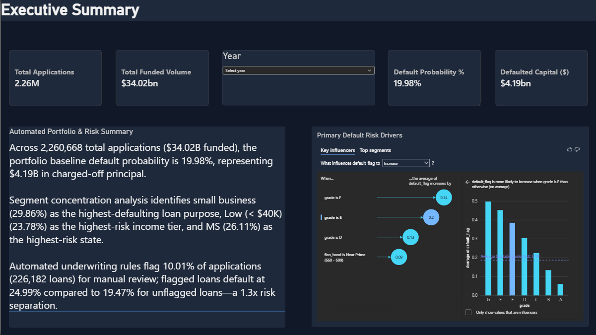
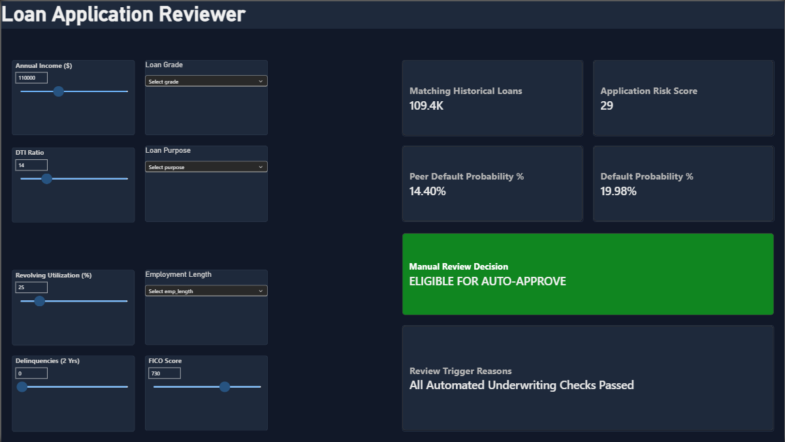
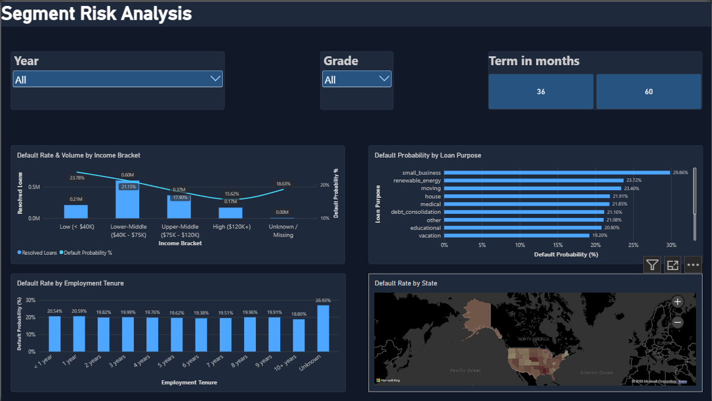
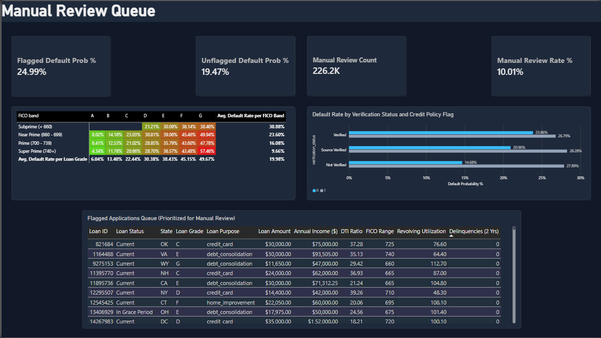

# Credit Risk Analytics & Automated Underwriting Decision System (LendingClub)


> **Interactive Power BI Model (`.pbix`):** [Download Latest Release (`v1.0.0`)](../../releases) *(All 2.26M compressed records embedded—open directly in Power BI Desktop with no SQL setup required)*

---

## 1. Executive Overview & Business Problem

Consumer lenders must balance **straight-through approval speed** against **capital preservation from high-risk defaults**. Analyzing **2,260,668 LendingClub loan applications** (**$34.02B** in funded volume), this end-to-end analytics and decision-support system answers two core credit risk questions:

1. **Customer Risk Segmentation:** Which borrower segments exhibit the highest historical loan default probability across **Income Bracket**, **Loan Type / Purpose**, **Employment History**, and **Geography**?
2. **Automated Underwriting & Triage:** Which incoming applications should be routed for **Manual Review** versus **Auto-Approval**, and how effectively do policy triggers separate bad credit risk?



---

## 2. Key Analytical Findings & Business Impact

* **Portfolio Baseline (`19.98%` Default Rate):** Across ~1.35M resolved loans (`Fully Paid` vs. `Charged Off` / `Default`), **19.98%** ended in default, representing **$4.19B** in charged-off principal.
* **Income Bracket Risk Gradient:** Default probability moves inversely with income—peaking in the **`Low (< $40K)`** tier at **`23.78%`** and declining steadily to **`15.62%`** for **`High ($120K+)`** earners.
* **Loan Purpose & Credit Grade Separation:** **`small_business`** loans carry the highest purpose risk at **`29.86%`** (vs. `19.20%` for `vacation`), while credit grades follow a steep monotonic risk curve from **`6.04%` (Grade A)** to **`49.67%` (Grade G)**.
* **Employment Tenure Stability:** Borrowers with **`Unknown`** employment tenure default at **`26.93%`** and **`< 1 year`** at **`20.54%`**, whereas **`10+ years`** of tenure lowers default risk to **`18.80%`**.
* **Geographic Risk Concentration:** Among states with $\ge 500$ resolved loans, **Mississippi (`MS`)** records the highest default rate at **`26.11%`**.
* **Underwriting Rule Effectiveness (`1.3x` Risk Lift):** Automated policy rules flag **`10.01%`** of applications (**`226,182` loans**) for manual review. Flagged loans default at **`24.99%`** compared to **`19.47%`** for unflagged loans—isolating high-risk borrowers while keeping ~90% of applications eligible for automated approval.

---

## 3. End-to-End Architecture & Data Modeling

```text
[Raw LendingClub CSVs] ──▶ [Python ETL & Quality Flags] ──▶ [MySQL Star Schema & BI View] ──▶ [Power BI 4-Page Report]
```

### Dataset Scoping (`accepted.csv` vs. `rejected.csv`)
* **`accepted.csv` (Core Star Schema):** Used to model default probability and underwriting rules because repayment outcomes (`Fully Paid` vs. `Charged Off`) only exist on funded loans. Active `Current` loans are isolated via `outcome_eligible_flag = 1` when calculating historical default rates to prevent maturity bias.
* **`rejected.csv` (Exploratory Funnel Profiling):** Profiled (~27.6M declined applications) during exploratory analysis to validate LendingClub's automated rejection cutoffs (such as FICO `< 660` and extreme DTI ratios), but excluded from default probability modeling as unissued applications have no repayment history.

### MySQL Star Schema (`lending_club_db`)
* **`fact_loan` & `vw_fact_loan_bi`:** Grain at one row per loan (`loan_id`), storing funded amounts, interest rates, DTI, FICO bands, income brackets, data-quality flags (`dti_999_flag`, `revol_util_over_100_flag`), and underwriting flags (`default_flag`, `outcome_eligible_flag`, `manual_review_flag`).
* **`dim_borrower_profile`:** Borrower attributes (`addr_state`, `emp_length`, `home_ownership`).
* **`dim_loan_characteristics`:** Loan product attributes (`grade`, `purpose`, `term_months`, `verification_status`, `credit_policy_flag`).
* **`dim_loan_status` & `dim_date`:** Loan outcome lookup and issue-date calendar hierarchy.

---

## 4. Dashboard Walkthrough (4 Interactive Pages)

### Page 1: Executive Summary
High-level portfolio KPIs (`2.26M` applications, `$34.02B` funded, `19.98%` default rate, `$4.19B` defaulted capital), a dynamic DAX portfolio summary narrative (`TOPN` highest-risk segments), and Power BI's **Key Influencers** ML visual.

### Page 2: Loan Application Reviewer (Live Underwriting Simulator)
Interactive "What-If" credit scoring tool powered by 5 numeric range parameters (`Annual Income`, `DTI Ratio`, `Revolving Utilization`, `Delinquencies`, `FICO Score`) and 3 disconnected category slicers (`Loan Grade`, `Loan Purpose`, `Employment Length`). Dynamically computes peer cohort default probability, a `0–100` risk score, trigger explanations, and **`ELIGIBLE FOR AUTO-APPROVE`** vs. **`MANUAL REVIEW REQUIRED`** status.



### Page 3: Segment Risk Analysis
Multi-dimensional default exploration across **Income Bracket** (volume vs. default rate combo chart), **Loan Purpose**, **Employment Tenure**, and **US State** choropleth map—filterable by `Year`, `Grade`, and `Term in months`.



### Page 4: Manual Review Queue
Validates automated underwriting rules (`24.99%` flagged vs. `19.47%` unflagged default rate), visualizes risk density across a **`Loan Grade × FICO Band`** heatmap matrix and verification-status bar chart, and surfaces a prioritized worklist of flagged loans.



---

## 5. Underwriting & Risk Scoring Logic

An application is routed to **`MANUAL REVIEW REQUIRED`** if it triggers **any** hard risk threshold or matches a high-risk historical peer cohort:

* **Debt-to-Income (`DTI`):** `>= 35%` *(+15 risk score pts)*
* **Credit Score (`FICO`):** `< 660` *(+15 risk score pts)*
* **Revolving Utilization:** `> 100%` *(+10 risk score pts)*
* **Recent Delinquencies (2 Yrs):** `>= 2` *(+10 risk score pts)*
* **Peer Cohort Default Rate:** `>= 25.0%` historical default rate *(up to 60 risk score pts; uses an exact 5-factor cohort match with automatic 2-factor fallback for sparse subprime combinations)*

---

## 6. Repository Structure & Local Setup

```text
loan-default-risk-analytics/
├── assets/
│   ├── 01_executive_summary.png
│   ├── 02_loan_application_reviewer.png
│   ├── 03_segment_risk_analysis.png
│   └── 04_manual_review_queue.png
├── data/
│   └── sample_lending_club_100rows.csv
├── scripts/
│   ├── accepted_csv_cleaning.py
│   └── requirements.txt
├── sql/
│   ├── 01_load_staging_data.sql
│   ├── 02_create_star_schema.sql
│   └── 03_create_bi_view.sql
├── .env.example
├── .gitattributes
├── .gitignore
└── README.md
```

### How to Explore or Reproduce
1. **Explore Without Running Code:** Download the `.pbix` model from the **[Releases](../../releases)** tab and open it directly in Power BI Desktop.
2. **Reproduce the Python & MySQL Pipeline:**
   ```bash
   git clone https://github.com/ParimalD1903/Loan Default Risk Analytics.git
   cd Loan Default Risk Analytics
   pip install -r scripts/requirements.txt
   ```
   * Download `accepted_2007_to_2018Q4.csv` from the LendingClub Kaggle dataset into `data/raw/` (or inspect `data/sample_lending_club_100rows.csv` for raw schema structure).
   * Run `python scripts/accepted_csv_cleaning.py` to generate `data/cleaned/accepted_loans_cleaned.csv`.
   * Execute `sql/01_load_staging_data.sql`, `sql/02_create_star_schema.sql`, and `sql/03_create_bi_view.sql` sequentially in MySQL 8.0+.